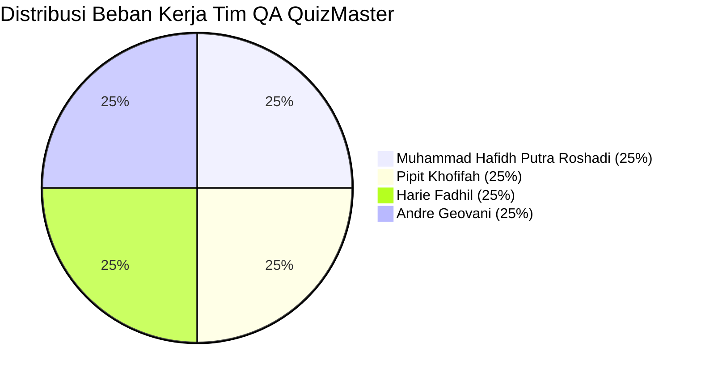

# Matriks Kontribusi Anggota Tim (Team Contributions)
## Mini Quality Assurance Audit — Platform QuizMaster SMAN 4 Padang

Mata Kuliah: **Quality Assurance (S1 Pendidikan Teknik Informatika)**  
Topik: **Mini Quality Assurance Audit — From Requirements to Test Evidence (Pertemuan 1 s.d 8)**

---

### 1. Pembagian Tugas & Tanggung Jawab Anggota Tim

Proyek audit mutu ini dirancang, dieksekusi, dan didokumentasikan secara kolaboratif oleh 4 mahasiswa dengan pembagian peran profesional:

---

### 2. Rincian Kontribusi Individual

#### 1. Muhammad Hafidh Putra Roshadi
- **Peran Resmi:** **Lead QA & Test Strategy Architect**
- **Kontribusi Tahapan (Stages):**
  - **Tahap 1 (P01):** Menyusun konsep kualitas ISO/IEC 25010, menganalisis profil pengguna sekolah, memetakan perbedaan QA vs QC, dan menghitung estimasi *Cost of Quality (CoQ)* sebesar Rp 7.400.000.
  - **Tahap 4 (P04):** Merancang strategi pengujian menyeluruh (*Test Strategy & Test Plan*), menentukan *in-scope* dan *out-of-scope*, serta menetapkan *Quality Gate Criteria*.
  - **Tahap 8 (P08):** Memimpin evaluasi kriteria keluar (*exit criteria*), menganalisis sisa risiko kualitas (*residual risk*), dan menandatangani keputusan akhir rilis (*Go/No-Go Recommendation: GO*).
  - **Kompilasi Laporan Word:** Mengorkestrasi penggabungan seluruh isi bab dan tabel ke dalam dokumen format Microsoft Word (`Laporan_Mini_QA_Audit_QuizMaster.docx`).
- **Persentase Kontribusi:** **25%**

---

#### 2. Pipit Khofifah
- **Peran Resmi:** **Senior Test Case Designer & Requirements Analyst**
- **Kontribusi Tahapan (Stages):**
  - **Tahap 3 (P03):** Merumuskan 5 spesifikasi kebutuhan fungsional formal (REQ-01 s.d REQ-05) dan menuliskan Acceptance Criteria dalam sintaks *Gherkin (Given-When-Then)*.
  - **Tahap 5 (P05):** Menyusun berkas `test-cases/05_Test_Cases.csv` dengan 12 skenario terstruktur dan merancang Matriks Ketertelusuran Kebutuhan (`test-cases/05_RTM.csv`).
  - **Tahap 6 (P06):** Merancang pengujian Black-Box secara teoritis dan praktis:
    * Pembagian partisi valid dan invalid pada *Equivalence Partitioning* (EP).
    * Analisis titik batas kritis KKM 80 (skor 79, 80, 81) pada *Boundary Value Analysis* (BVA).
    * Matriks aturan logika pada *Decision Table Testing* (DT).
    * Pemodelan mesin status (*state machine*) pada *State Transition Testing* (ST).
- **Persentase Kontribusi:** **25%**

---

#### 3. Harie Fadhil
- **Peran Resmi:** **Defect Analyst & RCA Lead**
- **Kontribusi Tahapan (Stages):**
  - **Tahap 3 (P03):** Menyusun Register Risiko Kualitas (*Quality Risk Register*) dengan matriks probabilitas $\times$ dampak ($5 \times 5$), serta menentukan strategi mitigasi untuk 3 risiko prioritas tertinggi.
  - **Tahap 7 (P07):** Memimpin manajemen cacat sistem:
    * Mengidentifikasi anomali *Unexpected Class Lockout* saat siswa remedial mandiri di rumah (DEFECT-01).
    * Mendeteksi kegagalan intent matching pada AI Chatbot Gemini guru saat menerima ejaan informal dan typo (DEFECT-03).
    * Menganalisis akar penyebab secara mendalam menggunakan metodologi **5-Why Root Cause Analysis (RCA)** untuk setiap cacat.
    * Memverifikasi keberhasilan perbaikan kode (*Defect Re-testing*) hingga seluruh status berubah menjadi **CLOSED**.
- **Persentase Kontribusi:** **25%**

---

#### 4. Andre Geovani
- **Peran Resmi:** **Automation & Evidence Engineer**
- **Kontribusi Tahapan (Stages):**
  - **Tahap 2 (P02):** Memetakan alur *QA Lifecycle*, mendokumentasikan aktivitas *Shift-Left* dan *Shift-Right*, serta mengeksekusi 61 skrip pengujian regresi otomatis Node.js (`verify_*.js`) dengan hasil kelulusan 100%.
  - **Tahap 6 & 7 (P06 & P07 - Evidence Capture):** Mengoperasikan Chrome DevTools MCP untuk mengeksekusi 12 skenario Black-Box dan mengambil 15 berkas tangkapan layar autentik beresolusi tinggi di folder `evidence/`.
  - **Audit Responsivitas Mobile:** Mengidentifikasi dan memverifikasi perbaikan cacat tata letak mobile (DEFECT-02: penambahan safe-area padding $120\text{px}$ pada layar ponsel) agar tombol navigasi dan portal dasbor guru tidak tertutup oleh tombol melayang (*Floating Action Button*).
- **Persentase Kontribusi:** **25%**

---

### 3. Matriks Rekapitulasi Tahapan dan Penanggung Jawab

| Tahap Audit (Pertemuan) | Judul Luaran (Deliverable) | Format Berkas | Penanggung Jawab Utama | Kontributor Pendukung |
|:---:|---|---|---|---|
| **Tahap 1 (P01)** | Quality Assessment & ISO 25010 | `docs/01_Quality_Assessment.md` | Muhammad Hafidh P. R. | Harie Fadhil |
| **Tahap 2 (P02)** | QA Lifecycle & Shift-Left Testing | `docs/02_QA_Lifecycle.md` | Andre Geovani | Muhammad Hafidh P. R. |
| **Tahap 3 (P03)** | Requirements & Risk Register | `docs/03_Requirement_Risk_Register.md` | Pipit Khofifah | Harie Fadhil |
| **Tahap 4 (P04)** | Test Strategy & Test Plan | `docs/04_Test_Strategy_Plan.md` | Muhammad Hafidh P. R. | Andre Geovani |
| **Tahap 5 (P05)** | Test Cases & RTM | `test-cases/05_Test_Cases.csv` & `05_RTM.csv` | Pipit Khofifah | Muhammad Hafidh P. R. |
| **Tahap 6 (P06)** | Black-Box Design & Execution (20%) | `docs/06_Black_Box_Design.md` & `evidence/*.png` | Pipit Khofifah | Andre Geovani |
| **Tahap 7 (P07)** | Defect Report & 5-Why RCA | `docs/07_Defect_Report_RCA.md` | Harie Fadhil | Andre Geovani |
| **Tahap 8 (P08)** | QA Audit Final Report & Sign-Off | `docs/08_QA_Audit_Final_Report.md` | Muhammad Hafidh P. R. | Seluruh Anggota |
| **Kompilasi** | Laporan Word Resmi untuk Moodle | `Laporan_Mini_QA_Audit_QuizMaster.docx` | Muhammad Hafidh P. R. | Seluruh Anggota |

---
*Matriks kontribusi ini disusun secara jujur dan transparan sebagai bukti komitmen kerja sama tim dalam menghasilkan produk perangkat lunak pendidikan yang bermutu tinggi.*

