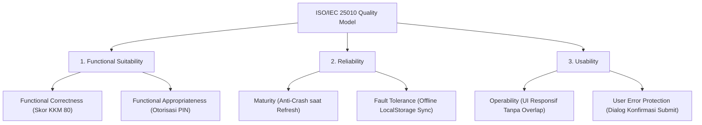
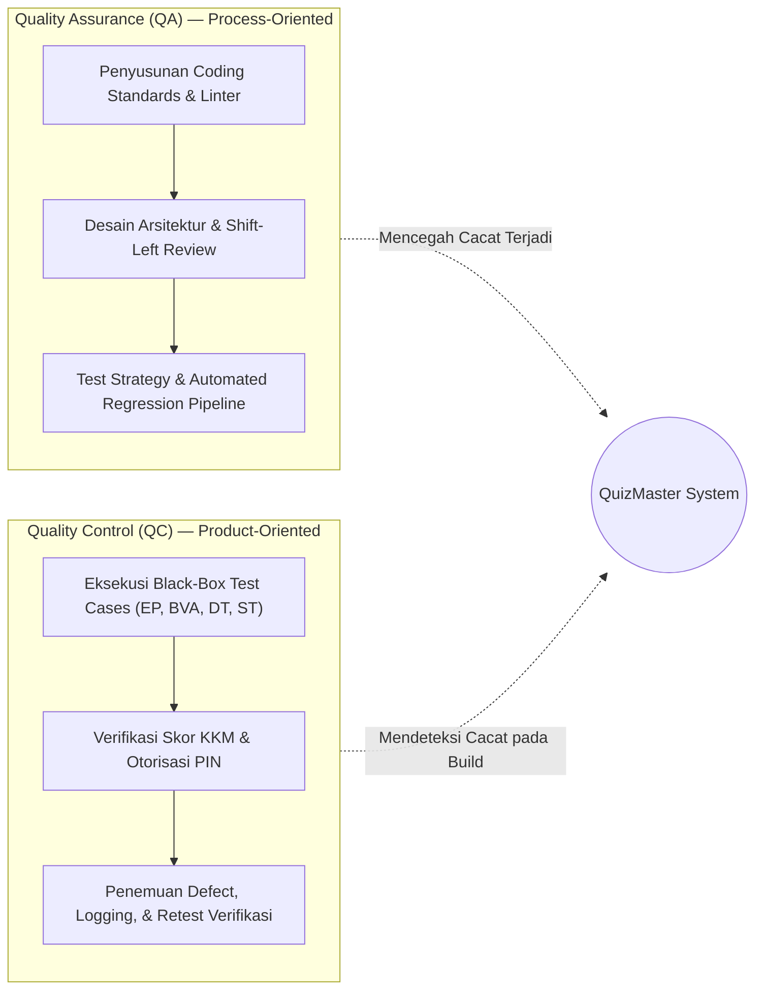

# Dokumen P01: Quality Assessment & ISO/IEC 25010
## Mini Quality Assurance Audit — Platform QuizMaster SMAN 4 Padang

---

### Identitas Proyek & Tim QA
- **Nama Perangkat Lunak:** QuizMaster — Platform Kuis Interaktif & Evaluasi Cerdas
- **Institusi Sasaran:** SMAN 4 Padang (Fokus Kelas X E.1 – X E.6)
- **Mata Kuliah:** Quality Assurance (S1 Pendidikan Teknik Informatika)
- **Tim Penguji:**
  1. **Muhammad Hafidh Putra Roshadi** (Lead QA & Test Strategy Architect)
  2. **Pipit Khofifah** (Senior Test Case Designer & Requirements Analyst)
  3. **Harie Fadhil** (Defect Analyst & RCA Lead)
  4. **Andre Geovani** (Automation & Evidence Engineer)
- **Versi Aplikasi:** v3.0.02 (Release Candidate)
- **URL Produksi:** [https://waphafid-code.github.io/kuis-detektif-fakta/](https://waphafid-code.github.io/kuis-detektif-fakta/)

---

### 1. Deskripsi Perangkat Lunak & Target Pengguna
**QuizMaster** adalah Single-Page Application (SPA) berbasis web modern yang dirancang khusus untuk memfasilitasi ujian interaktif, latihan soal, remedial otomatis, dan pemantauan analitik hasil belajar siswa secara *real-time*.

Aplikasi ini melayani dua profil pengguna utama:
1. **Siswa (Target: 216 Siswa Kelas X E.1 s.d X E.6):**
   - Mengakses paket soal ujian (Modul 1: Detektif Fakta, Modul 2: Keamanan Jaringan & Sistem Informasi).
   - Menikmati antarmuka adaptif (desktop & mobile-friendly), navigasi soal cepat, timer ujian otomatis, dan hasil analisis capaian kompetensi pasca-ujian (Tuntas jika skor $\ge 80$, Remedial jika $< 80$).
2. **Guru Pengampu / Administrator (Dra. Nurul H.):**
   - Mengakses Portal Dasbor Guru melalui otorisasi keamanan PIN terenkripsi SHA-256.
   - Mengontrol jadwal pembukaan kelas (*Always Open* vs *Jadwal Terkunci*), live monitor partisipasi, export nilai ke CSV/Excel, serta berkonsultasi analitik dengan **Asisten Analisis Pintar Gemini** (AI Chatbot Guru).

---

### 2. Tiga Karakteristik Kualitas ISO/IEC 25010 Paling Krusial

Berdasarkan standar internasional ISO/IEC 25010 (Software Product Quality Model), tim QA menetapkan 3 karakteristik inti yang paling krusial untuk aplikasi ujian sekolah:

#### A. Functional Suitability (Kesesuaian Fungsional)
- **Sub-karakteristik:** *Functional Correctness* & *Functional Appropriateness*.
- **Justifikasi:** Sistem evaluasi akademik tidak boleh memiliki toleransi kesalahan perhitungan nilai sekecil apa pun. Penentuan status kelulusan KKM ($\ge 80$) menentukan nasib remedial siswa. Jika skor salah dihitung, integritas akademik sekolah runtuh.

#### B. Reliability (Keandalan Sistem)
- **Sub-karakteristik:** *Fault Tolerance* & *Recoverability*.
- **Justifikasi:** Ujian berlangsung serentak oleh puluhan siswa menggunakan jaringan Wi-Fi sekolah yang rentan *intermittent drop*. Sistem harus memiliki ketahanan state (*Exam State Persistence*) di `localStorage` sehingga siswa yang tidak sengaja merefresh halaman tidak kehilangan jawaban dan sisa waktu ujian.

#### C. Usability (Ketergunaan & Pengalaman Pengguna)
- **Sub-karakteristik:** *User Interface Aesthetics*, *Operability*, dan *Accessibility*.
- **Justifikasi:** Lebih dari 70% siswa mengakses kuis melalui smartphone (layar kecil 360px - 412px). Komponen antarmuka tidak boleh saling menumpuk (*overlapping*), terpotong (*clipped*), atau menutupi tombol penting seperti tombol navigasi kuis dan portal dasbor guru.

---

### 3. Tiga Potensi Masalah Kualitas Spesifik & Dampaknya

| No | Potensi Masalah Kualitas | Komponen Terkait | Dampak terhadap Siswa / Guru |
|---|---|---|---|
| 1 | **Unexpected Class Lockout Outside Timetable Slot** | Modul Kontrol Akses (`access_control.js`) | Siswa tiba-tiba tidak dapat mengakses ujian karena validasi jadwal mendeteksi di luar jam pelajaran, padahal guru tidak bermaksud mengunci kelas. Menimbulkan kepanikan massal saat remedial di rumah. |
| 2 | **Mobile FAB Chatbot Overlap with Navigation/Portal Buttons** | Mobile UI Viewport (`style.css` & `teacher_chatbot.js`) | Tombol Floating Action Button (FAB) chatbot AI menutupi tombol 'Portal Dasbor Guru' atau tombol 'Mulai Kuis' pada resolusi layar $\le 412\text{px}$, menyebabkan tombol di baliknya tidak dapat ditekan (*unclickable*). |
| 3 | **AI Chatbot NLP Intent Matching Failure** | Engine Analitik Guru (`teacher_chatbot.js`) | Kueri guru yang mengandung variasi penulisan kelas (misal: "E1" alih-alih "10E1") atau typo (misal: "menegrjkana") gagal dikenali dan memicu respons *fallback* ucapan selamat datang berulang kali. |

---

### 4. Perbedaan Peran QA vs QC dalam Siklus Hidup QuizMaster

| Parameter | Quality Assurance (QA) | Quality Control (QC) |
|---|---|---|
| **Fokus Utama** | *Process-oriented* (Mencegah defect masuk ke kode). | *Product-oriented* (Mendeteksi defect pada aplikasi jadi). |
| **Penerapan di QuizMaster** | Mengatur standarisasi penyimpanan jawaban terisolasi per user di `localStorage`, merancang skema validasi PIN SHA-256, dan membuat 61 skrip *automated regression test*. | Menjalankan 12 skenario uji Black-Box (EP, BVA, Decision Table, State Transition), menginspeksi tampilan mobile di Chrome DevTools, dan memverifikasi skor batas 79 vs 80. |
| **Pelaksana** | Tim QA selama perancangan arsitektur dan siklus sprint. | Tester pada tahap verifikasi rilis *Release Candidate*. |

---

### 5. Estimasi Cost of Quality (CoQ)

Penerapan Cost of Quality (CoQ) membagi biaya kualitas menjadi **Cost of Conformance** (Biaya Pencegahan & Penilaian) dan **Cost of Non-Conformance** (Biaya Kegagalan Internal & Eksternal):

| Kategori CoQ | Aktivitas Kualitas | Estimasi Jam Kerja | Estimasi Biaya (Rp) |
|---|---|:---:|:---:|
| **Prevention Costs** | Penyusunan Test Plan, penentuan arsitektur modular, standarisasi exception handling. | 24 Jam | Rp 2.400.000 |
| **Appraisal Costs** | Eksekusi automated regression testing (61 tes), manual cross-browser testing, review kode. | 32 Jam | Rp 3.200.000 |
| **Internal Failure Costs** | Debugging bug lockout kelas, refactor regex NLP chatbot guru, perbaikan CSS layout mobile sebelum rilis. | 18 Jam | Rp 1.800.000 |
| **External Failure Costs** | Potensi penanganan komplain 216 siswa, pengulangan sesi ujian jika crash, perbaikan reputasi sekolah (*dihindari sepenuhnya*). | 0 Jam (*Mitigated*) | Rp 0 |
| **TOTAL CoQ** | **Investasi Kualitas QuizMaster** | **74 Jam** | **Rp 7.400.000** |

> **Kesimpulan CoQ:** Dengan mengalokasikan investasi pada *Prevention* dan *Appraisal* (Shift-Left), QuizMaster berhasil menekan *External Failure Costs* menjadi **Rp 0**, memastikan ujian daring 216 siswa berjalan mulus tanpa insiden kegagalan di hari pelaksanaan.

