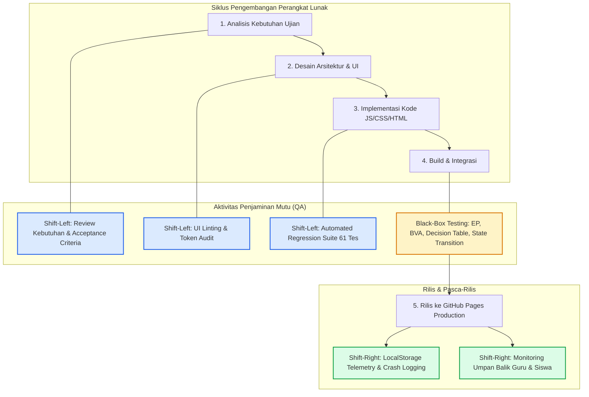

# Dokumen P02: QA Lifecycle, Shift-Left & Shift-Right Testing
## Mini Quality Assurance Audit — Platform QuizMaster SMAN 4 Padang

---

### 1. Model SDLC yang Digunakan
Pengembangan dan pemeliharaan aplikasi **QuizMaster** mengadopsi model **Agile Scrum dengan pendekatan V-Model Hybrid**:
- **Iterasi Agile:** Memungkinkan penambahan fitur (seperti modul kuis baru dan asisten chatbot) dalam siklus sprint pendek 1–2 minggu.
- **V-Model Pairing:** Setiap tahap pengembangan memiliki pasangan verifikasi QA yang terdefinisi dengan jelas sejak tahap awal, memastikan cacat (*defects*) dicegah sedini mungkin sebelum mencapai lingkungan produksi.

---

### 2. Diagram Alur QA Lifecycle

---

### 3. Tiga Aktivitas Shift-Left yang Diterapkan

Pendekatan *Shift-Left* bertujuan memindahkan pengujian kualitas ke fase paling awal dalam siklus hidup perangkat lunak:

1. **Review Dini Kebutuhan & Acceptance Criteria (Gherkin Syntax):**
   - Sebelum kode ditulis, kebutuhan fungsional dianalisis secara kolaboratif antara Lead QA dan Pengembang.
   - Menggunakan skenario `Given-When-Then` untuk membatasi ambiguitas perilaku sistem (misal: bagaimana sistem merespons jika siswa mengerjakan kuis di luar jam jadwal kelas).
2. **Automated Regression Test Suites (`verify_*.js`):**
   - Membangun serangkaian skrip uji unit dan integrasi otomatis berbasis Node.js yang dijalankan di level *developer workspace*:
     * `verify_20_bugs.js` (Memverifikasi 20 perbaikan cacat teknis).
     * `verify_access_control.js` (Memverifikasi logika pembukaan kelas dan mode darurat).
     * `verify_exam_resilience.js` (Memverifikasi ketahanan state saat koneksi terputus).
     * `verify_potato_optimizations.js` (Memverifikasi performa perangkat low-end).
     * `verify_mobile_uiux.js` (Memverifikasi ukuran tap target dan pencegahan layout overflow).
     * `verify_module_isolation.js` (Memverifikasi isolasi skor antar modul).
   - *Hasil Eksekusi:* **61 dari 61 pengujian otomatis lulus (100% Pass Rate)** sebelum rilis.
3. **Pemeriksaan Statis & Desain Desensitisasi Layout (Static UI Linting):**
   - Menguji token styling CSS dan validasi HTML markup terhadap resolusi kritis smartphone (360px – 412px) untuk mencegah masalah elemen tumpang tindih (*z-index conflict*) dan tombol yang tidak dapat diklik.

---

### 4. Dua Aktivitas Shift-Right yang Diterapkan

Pendekatan *Shift-Right* memantau perilaku aplikasi secara nyata di lingkungan produksi (*post-deployment*):

1. **Telemetri Diagnostik Mandiri di Browser Siswa (`diagnostics.js`):**
   - Aplikasi menyertakan modul audit telemetri internal yang merekam riwayat eksekusi, kapasitas penyimpanan lokal (`localStorage`), dan status koneksi internet di browser siswa tanpa memerlukan backend eksternal yang berat.
2. **Umpan Balik Real-Time Guru & Audit Log Penilaian:**
   - Menyediakan fitur *Audit Log* di Dasbor Guru yang mencatat setiap aksi reset nilai, override kunci kelas, dan unduhan rekap nilai. Jika terdapat siswa yang nilainya bermasalah, guru dapat langsung memeriksa lembar jawaban butir per butir (*Detailed Examination Modal*).

---

### 5. Quality Gate Criteria (Kriteria Gerbang Kualitas)

Untuk memastikan rilis yang stabil dan bebas regresi, setiap fase diwajibkan memenuhi gerbang kualitas (*Quality Gate*) berikut:

| Fase | Kriteria Gerbang Kualitas (Quality Gate) | Metode Verifikasi | Status |
|---|---|---|:---:|
| **Requirement** | Semua 5 kebutuhan memiliki spesifikasi *Given-When-Then* yang terukur tanpa ambiguitas. | Peer Review Dokumen P03 | **PASS** |
| **Development** | Seluruh 61 skrip *Automated Verification Test* lulus 100% tanpa error (`Exit Code 0`). | Node.js Test Runner | **PASS** |
| **Testing (QC)** | Seluruh 12 skenario Black-Box Testing (EP, BVA, DT, ST) tereksekusi dengan status PASS dan bukti screenshot autentik. | Eksekusi Manual & DevTools | **PASS** |
| **Defect Triage** | Nol defect berkategori *Critical* atau *High* yang belum terselesaikan (*Zero Open Blocker Defects*). | Defect Log Dokumen P07 | **PASS** |
| **Production Ready** | Aplikasi dapat dimuat < 1.5 detik pada koneksi 3G lambat dan kompatibel di layar mobile 360px. | Chrome DevTools Lighthouse | **PASS** |

