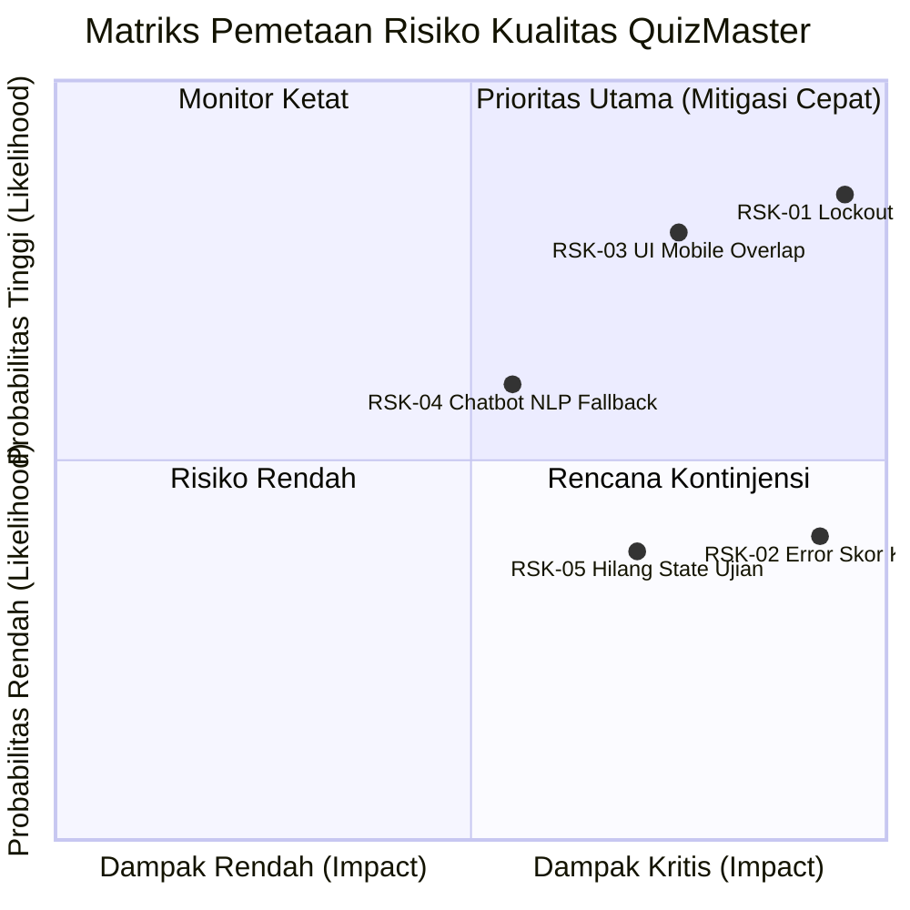

# Dokumen P03: Requirements Specification & Risk Register
## Mini Quality Assurance Audit — Platform QuizMaster SMAN 4 Padang

---

### 1. Spesifikasi Kebutuhan Uji Formal (REQ-01 s.d REQ-05)

Tim QA merumuskan 5 kebutuhan fungsional inti yang menjadi dasar pengujian sistem:

| ID Kebutuhan | Nama Kebutuhan | Deskripsi Fungsional |
|---|---|---|
| **REQ-01** | **Otorisasi Keamanan Portal Guru** | Sistem harus memvalidasi input PIN guru sepanjang tepat 6-digit numerik dengan mencocokkan nilai hash SHA-256. Akses hanya diberikan jika PIN cocok, dan menolak tegas PIN salah atau format non-numerik. |
| **REQ-02** | **Kalkulasi Nilai & Klasifikasi KKM 80** | Sistem harus menghitung skor akhir secara proporsional ($(\text{Benar} / 20) \times 100$) dan mengklasifikasikan siswa dengan skor $\ge 80$ sebagai **TUNTAS**, dan skor $< 80$ sebagai **REMEDIAL** beserta aktivasi sesi perbaikan. |
| **REQ-03** | **Tata Kelola Akses & Penjadwalan Ujian** | Sistem harus mengizinkan pengerjaan ujian jika status kelas *Always Open* atau berada di dalam rentang jadwal aktif, dan memblokir pengerjaan jika status kelas *Locked Override* atau melewati batas waktu tenggat (*Deadline Expired*). |
| **REQ-04** | **Transisi Siklus Hidup Ujian Siswa** | Sistem harus mengontrol perpindahan layar (*State Transition*) hanya melalui alur resmi: `Lobby (Home) -> Active Exam -> Results Screen`, serta melarang transisi langsung secara ilegal (misal langsung ke Results tanpa mengerjakan ujian). |
| **REQ-05** | **Pemrosesan Kueri Analitik AI Chatbot Guru** | Asisten Gemini Chatbot harus mampu memproses kueri bahasa alami dari guru mengenai status pengerjaan siswa, toleran terhadap variasi penyebutan kelas ("E1" vs "10E1") dan salah ketik (*typo*), serta menyajikan daftar siswa yang belum ujian secara akurat. |

---

### 2. Kriteria Penerimaan Formal (Acceptance Criteria - Given-When-Then)

#### A. Kriteria Penerimaan REQ-01 (Otorisasi PIN Guru)
```gherkin
Feature: Otorisasi Keamanan Dasbor Guru
  Scenario: Guru memasukkan PIN yang benar
    Given guru berada di halaman utama dan membuka modal PIN Dasbor Guru
    When guru memasukkan 6-digit PIN yang valid ("240804")
    Then sistem memvalidasi hash SHA-256 dan membuka layar Dasbor Manajemen Guru dalam waktu < 500ms

  Scenario: Guru memasukkan PIN salah
    Given guru berada di modal PIN Dasbor Guru
    When guru memasukkan 6-digit PIN yang tidak terdaftar ("123456")
    Then sistem menolak akses, menampilkan pesan peringatan merah "PIN Salah!", dan mengunci form input
```

#### B. Kriteria Penerimaan REQ-02 (Evaluasi Nilai KKM 80)
```gherkin
Feature: Klasifikasi Kelulusan KKM 80
  Scenario: Siswa mencapai batas persis nilai KKM
    Given siswa telah menyelesaikan 20 butir soal kuis
    When siswa menjawab benar tepat 16 dari 20 soal (Skor 80)
    Then sistem menampilkan status "TUNTAS", menerbitkan lencana kelulusan, dan menonaktifkan opsi remedial

  Scenario: Siswa mendapatkan skor 1 poin di bawah KKM
    Given siswa telah menyelesaikan 20 butir soal kuis
    When siswa menjawab benar tepat 15 dari 20 soal (Skor 75) atau simulasi skor 79
    Then sistem menampilkan status "REMEDIAL", menyajikan ringkasan butir salah, dan mengaktifkan tombol pengerjaan remedial
```

#### C. Kriteria Penerimaan REQ-03 (Kontrol Akses Jadwal Kelas)
```gherkin
Feature: Tata Kelola Akses Pengerjaan Siswa
  Scenario: Kelas dalam mode Always Open
    Given guru menyetel konfigurasi kelas X E.1 ke mode "Always Open"
    When siswa memilih kelas X E.1 dan menekan tombol "Mulai Kuis" kapan saja
    Then sistem mengizinkan siswa masuk ke sesi ujian tanpa terhalang jam sekolah

  Scenario: Guru mengunci kelas secara manual (Override Lock)
    Given status kelas X E.2 disetel menjadi "Terkunci (Manual Override)" oleh guru
    When siswa mencoba menekan tombol "Mulai Kuis"
    Then sistem menolak akses, menampilkan modal penguncian, dan mengarahkan siswa menghubungi guru
```

#### D. Kriteria Penerimaan REQ-05 (Pemrosesan Kueri Chatbot Guru)
```gherkin
Feature: NLP Chatbot Analitik Guru
  Scenario: Guru menanyakan siswa yang belum ujian dengan ejaan informal
    Given guru berada di Portal Dasbor Guru dan membuka widget Chatbot Pintar Gemini
    When guru mengetik kueri "SIAPA SAJA YANG BELUM MENEGRJKANA MODUL JARINGAN DI E1"
    Then chatbot mengekstraksi kelas "X E.1" dan modul "Keamanan Jaringan", lalu menyajikan daftar lengkap 36 nama siswa yang belum submit beserta tombol tindak lanjut
```

---

### 3. Register Risiko Kualitas (Quality Risk Register)

Penilaian risiko dilakukan menggunakan matriks standar probabilitas (*Likelihood*) dan dampak (*Impact*) dengan skala 1–5:
$$\text{Risk Score} = \text{Likelihood} \times \text{Impact}$$

| ID Risiko | Deskripsi Risiko Kualitas | Likelihood (1-5) | Impact (1-5) | Risk Score | Tingkat Risiko |
|:---:|---|:---:|:---:|:---:|:---:|
| **RSK-01** | **False Lockout Kelas saat Remedial Mandiri:** Siswa diblokir sistem karena jam belajar reguler berakhir, menghambat siswa remedial di rumah. | 4 | 5 | **20** | **CRITICAL** |
| **RSK-02** | **Kalkulasi Nilai KKM Tidak Presisi:** Kesalahan pembulatan float menyebabkan siswa berskor 79.9 dinyatakan lulus atau siswa 80 dinyatakan remedial. | 2 | 5 | **10** | **HIGH** |
| **RSK-03** | **Elemen UI Mobile Tumpang Tindih (FAB Overlap):** Tombol aksi melayang (FAB) menutupi tombol submit atau navigasi kuis di layar HP siswa. | 4 | 4 | **16** | **HIGH** |
| **RSK-04** | **Kegagalan Pemahaman Kueri Chatbot Guru:** Chatbot memicu fallback greeting berulang kali saat menerima variasi teks/typo dari guru. | 3 | 3 | **9** | **MEDIUM** |
| **RSK-05** | **Kehilangan State Ujian saat Koneksi Terputus:** Siswa yang tidak sengaja merefresh browser kehilangan seluruh jawaban yang telah dipilih. | 2 | 4 | **8** | **MEDIUM** |



---

### 4. Tiga Risiko Prioritas Tertinggi & Rencana Mitigasi

#### 1. Prioritas 1: RSK-01 — False Lockout Kelas (Risk Score: 20)
- **Akar Masalah:** Sistem secara default mengecek jam operasional sekolah (07.00 - 16.00 WIB) tanpa memeriksa apakah kelas sedang ditugaskan untuk remedial di luar jam sekolah.
- **Rencana Mitigasi:**
  1. Tambahkan konfigurasi eksplisit `Always Open` di pengaturan Dasbor Guru per kelas.
  2. Implementasikan flag `lockoutOverride: false` secara default untuk kuis penugasan mandiri.
  3. Buat pengujian Decision Table (TC-07, TC-08, TC-09) untuk menjamin akses tetap terbuka selama guru tidak mengaktifkan penguncian manual.

#### 2. Prioritas 2: RSK-03 — UI Mobile Overlap (Risk Score: 16)
- **Akar Masalah:** Posisi `fixed` pada tombol FAB Chatbot (`bottom: 24px, right: 24px`) bertabrakan dengan tombol aksi portal di viewport ponsel yang sempit ($\le 412\text{px}$).
- **Rencana Mitigasi:**
  1. Terapkan safe-area padding (`padding-bottom: 120px !important`) pada kontainer utama di breakpoint mobile.
  2. Sembunyikan FAB chatbot otomatis saat siswa memasuki mode ujian aktif (`body.exam-mode-active`).
  3. Validasi tampilan menggunakan Chrome DevTools MCP pada resolusi iPhone SE (375x667) dan Android Galaxy (360x780).

#### 3. Prioritas 3: RSK-02 — Error Kalkulasi Skor KKM (Risk Score: 10)
- **Akar Masalah:** Pembagian nilai dengan angka desimal dapat memicu *floating point inaccuracy* dalam JavaScript (misal $15/20 \times 100 = 75$, namun jika ada bobot desimal dapat menghasilkan $79.9999$).
- **Rencana Mitigasi:**
  1. Gunakan pembulatan deterministik bilangan bulat (`Math.round((correct / total) * 100)`).
  2. Uji nilai batas secara ketat menggunakan *Boundary Value Analysis* (BVA) pada titik $79$, $80$, dan $81$ (TC-04, TC-05, TC-06).
  3. Lakukan verifikasi otomatis melalui skrip `verify_module_isolation.js` dan `verify_20_bugs.js`.

