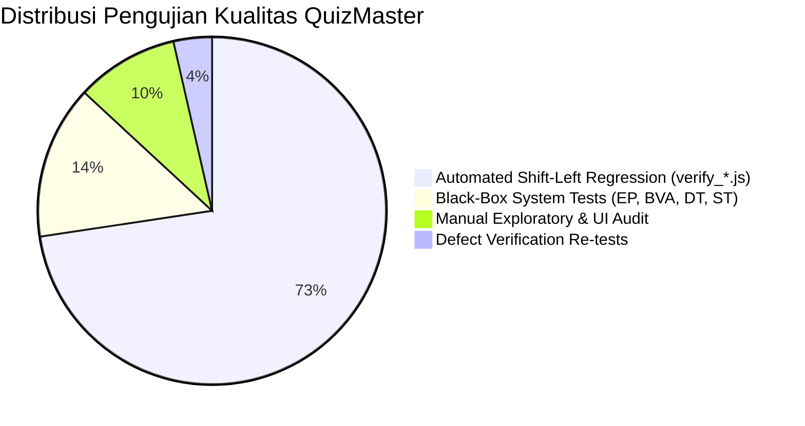
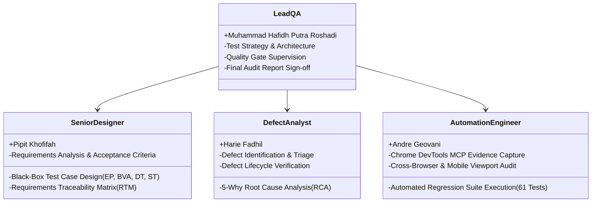

# Dokumen P04: Test Strategy & Test Plan
## Mini Quality Assurance Audit — Platform QuizMaster SMAN 4 Padang

---

### 1. Ruang Lingkup Pengujian (Scope of Testing)

#### A. In-Scope (Fitur yang Diuji Secara Komprehensif):
1. **Otorisasi & Keamanan Guru:** Form validasi 6-digit PIN Guru, hashing SHA-256, session lockout.
2. **Mesin Penilaian & KKM:** Kalkulasi nilai 20 butir soal, penentuan predikat kelulusan (KKM 80), logika remedial.
3. **Kontrol Akses Kelas:** Mode pengerjaan *Always Open*, *Schedule Time Window*, dan *Manual Override Lock*.
4. **Siklus Hidup Ujian Siswa (State Machine):** Alur transisi layar `Lobby -> Active Exam -> Results Screen` dan pencegahan *illegal skip*.
5. **Kecerdasan Buatan (AI Chatbot Guru):** Pemrosesan kueri bahasa alami (NLP), ekstraksi kelas dan modul, penanganan variasi penulisan/typo.
6. **Responsivitas & Layout Mobile:** Tampilan bebas tumpang tindih (*overlap-free*), kenyamanan tap target ($\ge 44\text{px}$), dan safe area scroll.
7. **Ketahanan Ujian (Offline Resilience):** Penyimpanan jawaban lokal di `localStorage` saat browser di-refresh.

#### B. Out-of-Scope (Tidak Termasuk dalam Audit Mini QA Ini):
1. Pengujian beban ekstrim (*Stress Testing* $\ge 10.000$ *concurrent users*) karena arsitektur berjalan secara *Client-Side SPA* dengan Google Firebase sync.
2. Integrasi Payment Gateway (karena aplikasi gratis untuk pendidikan SMAN 4 Padang).
3. Penetrasi keamanan tingkat kernel/hardware.

---

### 2. Level & Piramida Pengujian

| Tingkat Pengujian | Deskripsi & Pendekatan | Penanggung Jawab |
|---|---|---|
| **Unit Testing** | Menguji fungsi individual: penghitungan skor, hashing sha256 PIN, fungsi regex tokenizer chatbot guru. | Andre Geovani |
| **Integration Testing** | Menguji keterhubungan antar modul: interaksi `access_control.js` dengan antarmuka pemilihan kelas, isolasi state antar kuis di `localStorage`. | Muhammad Hafidh P. R. |
| **System Testing** | Menguji perilaku sistem secara *end-to-end* menggunakan teknik Black-Box (EP, BVA, Decision Table, State Transition). | Pipit Khofifah |
| **Acceptance Testing** | Menguji kesesuaian alur kerja dengan skenario riil guru pengampu (Dra. Nurul H.) dan 216 siswa SMAN 4 Padang. | Harie Fadhil |

---

### 3. Lingkungan Pengujian (Test Environment)

Pengujian dilakukan pada lingkungan yang mencerminkan profil perangkat guru dan siswa SMAN 4 Padang:

| Komponen | Spesifikasi Lingkungan Pengujian |
|---|---|
| **Perangkat Keras (Testing Host)** | AMD Ryzen / Intel Core i5+, RAM 16 GB, SSD 512 GB |
| **Sistem Operasi** | Windows 11 64-bit & Android 14 Mobile Simulator |
| **Peramban Web (Browsers)** | Google Chrome v131+ (Blink Engine), Microsoft Edge v131+, Mozilla Firefox v132+ |
| **Resolusi Viewport Diuji** | - **Desktop/Laptop:** $1920 \times 1080\text{px}$ & $1366 \times 768\text{px}$ - **Tablet:** $768 \times 1024\text{px}$ (iPad Portrait) - **Smartphone:** $375 \times 667\text{px}$ (iPhone SE), $360 \times 780\text{px}$ (Samsung Galaxy), $412 \times 915\text{px}$ (Pixel 7) |
| **Kondisi Jaringan** | Wi-Fi Sekolah Cepat (50 Mbps), Simulasi 3G Lambat (*Chrome DevTools Throttling*), dan Mode Offline Disconnect |

---

### 4. Kriteria Masuk & Keluar (Entry & Exit Criteria)

#### Kriteria Masuk (Entry Criteria):
- Kode program stabil pada versi rilis *Release Candidate* (`v3.0.02`).
- Seluruh dokumen kebutuhan (P01, P02, P03) telah disetujui tim QA.
- Lingkungan server pengujian lokal (Node/HTTP server) dan live deployment di GitHub Pages telah aktif.
- Seluruh 61 skrip *Automated Regression Suite* lulus 100%.

#### Kriteria Keluar (Exit Criteria):
- 100% test case Black-Box (12 test case) telah dieksekusi dengan status **PASS**.
- 0 *Critical Defect* dan 0 *High Defect* berstatus *Open*.
- Seluruh cacat yang ditemukan telah memiliki Root Cause Analysis (5-Why RCA), solusi kode terverifikasi, dan status **CLOSED**.
- Matriks Ketertelusuran Kebutuhan (RTM) memiliki cakupan (*coverage*) 100% terhadap REQ-01 s.d REQ-05.
- Tersedia bukti tangkapan layar (*evidence screenshots*) autentik untuk setiap skenario.

---

### 5. Struktur Tim & Pembagian Peran (Team Assignment)

Proyek audit ini dikerjakan oleh tim QA yang terdiri dari 4 mahasiswa S1 Pendidikan Teknik Informatika:

| Nama Anggota | Peran dalam Tim | Tanggung Jawab Utama |
|---|---|---|
| **Muhammad Hafidh Putra Roshadi** | **Lead QA & Test Strategy Architect** | Mengorkestrasi strategi penjaminan mutu, menyusun dokumen P01 & P04, menetapkan Quality Gate, serta menandatangani laporan sign-off akhir (P08). |
| **Pipit Khofifah** | **Senior Test Case Designer & Requirements Analyst** | Merumuskan Acceptance Criteria formal (P03), mendesain 12 skenario uji Black-Box (P06), dan memetakan Requirements Traceability Matrix / RTM (P05). |
| **Harie Fadhil** | **Defect Analyst & RCA Lead** | Mendeteksi dan mendokumentasikan cacat sistem, memimpin analisis akar penyebab menggunakan 5-Why RCA, dan memverifikasi re-test cacat (P07). |
| **Andre Geovani** | **Automation & Evidence Engineer** | Menjalankan pipeline uji otomatis (61 pengujian Node.js), menangkap 15 bukti tangkapan layar autentik di Chrome DevTools, dan mengaudit performa mobile. |

---

### 6. Jadwal & Estimasi Pelaksanaan Uji

| Tahap | Aktivitas Pengujian | Durasi | Pelaksana | Output |
|:---:|---|:---:|---|---|
| 1 | Analisis Kebutuhan & Desain Acceptance Criteria | 2 Hari | Pipit Khofifah | Dokumen P01 & P03 |
| 2 | Perancangan Strategi Uji & Quality Gates | 1 Hari | Muhammad Hafidh P. R. | Dokumen P02 & P04 |
| 3 | Eksekusi Automated Regression Suite (61 Uji) | 1 Hari | Andre Geovani | Test Log 61/61 PASS |
| 4 | Eksekusi Black-Box Manual (EP, BVA, DT, ST) | 2 Hari | Pipit K. & Andre G. | 15 File Bukti Screenshots |
| 5 | Triage Defect, 5-Why RCA, & Re-testing | 2 Hari | Harie Fadhil | Dokumen P07 (Defects CLOSED) |
| 6 | Penyusunan RTM & Laporan Akhir Audit | 1 Hari | Seluruh Anggota Tim | Dokumen P08 & Word Report |
| **TOTAL** | **Siklus Lengkap Mini QA Audit** | **9 Hari** | **4 Anggota Tim** | **Produk Siap Rilis** |

