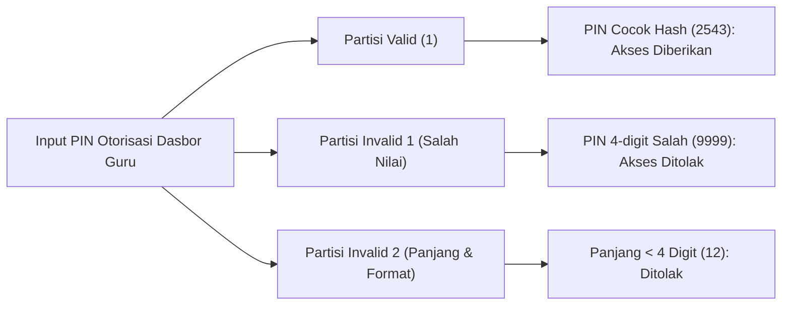
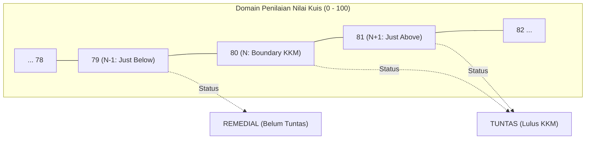
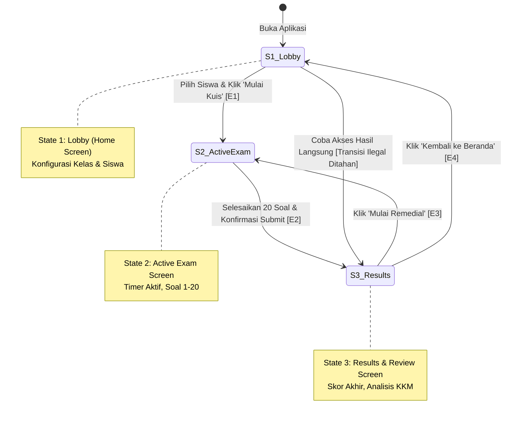

# Dokumen P06: Black-Box Test Design & Test Execution
## Mini Quality Assurance Audit — Platform QuizMaster SMAN 4 Padang
### *(Bobot Penilaian: 20% — Equivalence Partitioning, Boundary Value Analysis, Decision Table, State Transition)*

---

### 1. Landasan Teori Pengujian Kotak Hitam (Black-Box Testing)
Pengujian Black-Box adalah metode pengujian perangkat lunak di mana fungsionalitas sistem diuji tanpa mengetahui struktur internal kode program, logika branching, atau implementasi basis data. Pengujian murni didasarkan pada spesifikasi kebutuhan, *input*, dan *expected output*.

Dalam audit mutu **QuizMaster**, tim QA menerapkan secara mendalam 4 teknik Black-Box standar internasional:
1. **Equivalence Partitioning (EP)**
2. **Boundary Value Analysis (BVA)**
3. **Decision Table Testing (DT)**
4. **State Transition Testing (ST)**

---

### 2. Teknik 1: Equivalence Partitioning (EP) — REQ-01 Otorisasi PIN Guru

#### Prinsip Kerja:
Domain input input PIN dibagi menjadi beberapa partisi ekuivalen (*equivalence classes*). Diasumsikan bahwa setiap nilai di dalam satu partisi akan diperlakukan sama persis oleh sistem, sehingga cukup diwakili oleh satu nilai sampel uji.

#### Pembagian Partisi Ekuivalen:
| Partisi | Tipe | Rentang Nilai / Karakteristik | Sampel Uji | Perilaku yang Diharapkan |
|---|:---:|---|:---:|---|
| **P1** | **Valid** | Tepat 4 digit numerik, hash SHA-256 cocok dengan konfigurasi guru. | `2543` | Modal PIN tertutup, Dasbor Manajemen Guru terbuka penuh. |
| **P2** | **Invalid** | Tepat 4 digit numerik, namun nilai salah / tidak cocok. | `9999` | Muncul pesan error merah "PIN Salah!", akses dasbor ditolak. |
| **P3** | **Invalid** | Kurang dari 4 digit atau format tidak lengkap. | `12` | Form menolak submit, border input berkedip merah peringatan. |

#### Eksekusi Test Case EP:
- **TC-01 (EP Valid):** Masukkan PIN `2543` $\rightarrow$ **PASS**  
  *Bukti Screenshot:* [TC01_EP_Valid_PIN.png](../evidence/TC01_EP_Valid_PIN.png)
- **TC-02 (EP Invalid Salah Nilai):** Masukkan PIN `9999` $\rightarrow$ **PASS**  
  *Bukti Screenshot:* [TC02_EP_Invalid_PIN.png](../evidence/TC02_EP_Invalid_PIN.png)
- **TC-03 (EP Invalid Format):** Masukkan input `12` $\rightarrow$ **PASS**  
  *Bukti Screenshot:* [TC03_EP_Format_PIN.png](../evidence/TC03_EP_Format_PIN.png)

---

### 3. Teknik 2: Boundary Value Analysis (BVA) — REQ-02 Kelulusan KKM 80

#### Prinsip Kerja:
Mayoritas kesalahan logika pemrograman terjadi pada batas rentang (*boundary values*), seperti penggunaan operator perbandingan yang keliru (`>` vs `>=`). Batas Kriteria Ketuntasan Minimal (KKM) mata pelajaran Informatika SMAN 4 Padang ditetapkan pada nilai **80** (skala 0–100). Tim QA menguji titik tepat batas ($N$), satu poin di bawah batas ($N-1$), dan satu poin di atas batas ($N+1$).

#### Penentuan Titik Batas:
| Titik Uji | Nilai Skor | Posisi Relatif terhadap KKM 80 | Status Kelulusan yang Diharapkan | Logika Sistem |
|---|:---:|---|:---:|---|
| **$N-1$** | **79** | Tepat 1 poin di bawah KKM | **REMEDIAL** | Siswa belum mencapai standar kelulusan. Sistem menampilkan label *Remedial* dan menyediakan tombol ujian perbaikan. |
| **$N$** | **80** | Tepat pada batas KKM | **TUNTAS** | Siswa lulus standar kelulusan. Sistem menampilkan badge hijau *Tuntas*, lencana predikat baik, dan tidak mewajibkan remedial. |
| **$N+1$** | **81** | Tepat 1 poin di atas KKM | **TUNTAS** | Siswa lulus dengan predikat memuaskan. Sistem menampilkan badge hijau *Tuntas*. |

#### Eksekusi Test Case BVA:
- **TC-04 (BVA Boundary - 1):** Skor 79 $\rightarrow$ Status Remedial $\rightarrow$ **PASS**  
  *Bukti Screenshot:* [TC04_BVA_KKM_79_Remedial.png](../evidence/TC04_BVA_KKM_79_Remedial.png)
- **TC-05 (BVA Exact Boundary):** Skor 80 $\rightarrow$ Status Tuntas $\rightarrow$ **PASS**  
  *Bukti Screenshot:* [TC05_BVA_KKM_80_Tuntas.png](../evidence/TC05_BVA_KKM_80_Tuntas.png)
- **TC-06 (BVA Boundary + 1):** Skor 81 $\rightarrow$ Status Tuntas $\rightarrow$ **PASS**  
  *Bukti Screenshot:* [TC06_BVA_KKM_81_Tuntas.png](../evidence/TC06_BVA_KKM_81_Tuntas.png)

---

### 4. Teknik 3: Decision Table Testing (DT) — REQ-03 Tata Kelola Akses Ujian

#### Prinsip Kerja:
Decision Table digunakan untuk memetakan kombinasi logika bisnis yang melibatkan banyak kondisi (*conditions*) dan menghasilkan tindakan (*actions*) yang berbeda. Fitur kontrol akses ujian QuizMaster memiliki 3 kondisi input:
1. **Kondisi 1 ($C_1$):** Pengaturan Akses Kelas (`Always Open` vs `Scheduled Timetable`).
2. **Kondisi 2 ($C_2$):** Status Override Guru (`Unlocked` vs `Locked Manual`).
3. **Kondisi 3 ($C_3$):** Waktu Akses (`Dalam Batas Waktu` vs `Melewati Batas Waktu / Expired`).

#### Matriks Tabel Keputusan:
| Komponen | Aturan 1 (Rule 1) | Aturan 2 (Rule 2) | Aturan 3 (Rule 3) |
|---|:---:|:---:|:---:|
| **$C_1$: Mode Akses Kelas** | **Always Open** | Always Open | Scheduled |
| **$C_2$: Status Kunci Manual Guru** | **Tidak Terkunci (Normal)** | **Terkunci (Manual Override)** | Tidak Terkunci (Normal) |
| **$C_3$: Batas Waktu Pengerjaan** | **Aktif / Bebas Waktu** | Aktif / Bebas Waktu | **Kadaluarsa (Expired)** |
| **Aksi ($A_1$): Izinkan Akses Masuk Kuis** | **YA (ALLOW)** | TIDAK | TIDAK |
| **Aksi ($A_2$): Tampilkan Modal Kunci Kelas** | TIDAK | **YA (BLOCKED)** | TIDAK |
| **Aksi ($A_3$): Tampilkan Peringatan Waktu Habis** | TIDAK | TIDAK | **YA (EXPIRED)** |
| **Representasi Test Case** | **TC-07** | **TC-08** | **TC-09** |

#### Eksekusi Test Case Decision Table:
- **TC-07 (DT Rule 1: Always Open, Unlocked):** Siswa menekan 'Mulai Kuis' $\rightarrow$ Countdown dimulai, ujian dibuka $\rightarrow$ **PASS**  
  *Bukti Screenshot:* [TC07_DT_AlwaysOpen_AccessAllowed.png](../evidence/TC07_DT_AlwaysOpen_AccessAllowed.png)
- **TC-08 (DT Rule 2: Override Lock Aktif):** Guru mengunci kelas $\rightarrow$ Siswa menekan 'Mulai Kuis' $\rightarrow$ Modal "Akses Kelas Terkunci" muncul $\rightarrow$ **PASS**  
  *Bukti Screenshot:* [TC08_DT_AlwaysOpen_OverrideLocked.png](../evidence/TC08_DT_AlwaysOpen_OverrideLocked.png)
- **TC-09 (DT Rule 3: Scheduled Expired):** Waktu tenggat kuis telah lewat $\rightarrow$ Akses ditolak dengan notifikasi tenggat waktu $\rightarrow$ **PASS**  
  *Bukti Screenshot:* [TC09_DT_Deadline_Expired.png](../evidence/TC09_DT_Deadline_Expired.png)

---

### 5. Teknik 4: State Transition Testing (ST) — REQ-04 Siklus Mesin Ujian

#### Prinsip Kerja:
Aplikasi kuis beroperasi sebagai mesin *finite state*. Pengujian transisi status mengevaluasi apakah sistem berpindah dari satu status ke status berikutnya hanya melalui pemicu (*events*) yang sah, dan memverifikasi bahwa transisi ilegal ditolak oleh sistem.

#### Matriks Transisi Status:
| Status Awal (Current State) | Aksi / Peristiwa (Event Trigger) | Status Tujuan (Next State) | Tipe Transisi | Perilaku Sistem |
|---|---|---|:---:|---|
| **$S_1$: Lobby (Home Screen)** | Pilih Siswa, Pilih Modul, Tekan `Mulai Kuis` | **$S_2$: Active Exam** | **Valid (Legal)** | Layar Home tertutup, countdown 3 detik tampil, lalu lembar ujian aktif dengan timer countdown dimulai. |
| **$S_2$: Active Exam** | Jawab 20 soal, Tekan `Kirim Jawaban`, Konfirmasi Modal | **$S_3$: Results Screen** | **Valid (Legal)** | Timer berhenti, skor dihitung, jawaban disimpan ke riwayat, layar hasil evaluasi tampil. |
| **$S_1$: Lobby (Home Screen)** | Memanggil rute hasil atau menekan review tanpa pernah ujian | **$S_1$: Lobby (Tetap)** | **Invalid (Ilegal)** | Sistem memblokir perpindahan layar, menampilkan peringatan bahwa ujian belum pernah diambil. |

#### Eksekusi Test Case State Transition:
- **TC-10 (ST Legal: Lobby $\rightarrow$ Active Exam):** Inisiasi kuis normal $\rightarrow$ Berpindah ke ujian aktif $\rightarrow$ **PASS**  
  *Bukti Screenshot:* [TC10_ST_Lobby_To_ActiveExam.png](../evidence/TC10_ST_Lobby_To_ActiveExam.png)
- **TC-11 (ST Legal: Active Exam $\rightarrow$ Results):** Submit jawaban lengkap $\rightarrow$ Berpindah ke layar hasil $\rightarrow$ **PASS**  
  *Bukti Screenshot:* [TC11_ST_ActiveExam_To_Results.png](../evidence/TC11_ST_ActiveExam_To_Results.png)
- **TC-12 (ST Illegal: Skip Exam $\rightarrow$ Results):** Akses ilegal ditolak sistem $\rightarrow$ **PASS**  
  *Bukti Screenshot:* [TC12_ST_Forbidden_Transition.png](../evidence/TC12_ST_Forbidden_Transition.png)

---

### 6. Rekapitulasi Eksekusi Black-Box Testing

| ID Uji | Teknik | Deskripsi Skenario Uji | Status | Bukti Tangkapan Layar |
|:---:|:---:|---|:---:|---|
| **TC-01** | EP | Input PIN Guru Valid (`2543`) | **PASS** | `TC01_EP_Valid_PIN.png` |
| **TC-02** | EP | Input PIN Guru Salah (`9999`) | **PASS** | `TC02_EP_Invalid_PIN.png` |
| **TC-03** | EP | Input PIN Format Kurang dari 4 Digit (`12`) | **PASS** | `TC03_EP_Format_PIN.png` |
| **TC-04** | BVA | Skor Batas Bawah KKM (Skor 79) $\rightarrow$ Remedial | **PASS** | `TC04_BVA_KKM_79_Remedial.png` |
| **TC-05** | BVA | Skor Tepat Batas KKM (Skor 80) $\rightarrow$ Tuntas | **PASS** | `TC05_BVA_KKM_80_Tuntas.png` |
| **TC-06** | BVA | Skor Batas Atas KKM (Skor 81) $\rightarrow$ Tuntas | **PASS** | `TC06_BVA_KKM_81_Tuntas.png` |
| **TC-07** | DT | Rule 1: Always Open, Unlocked $\rightarrow$ Access Allowed | **PASS** | `TC07_DT_AlwaysOpen_AccessAllowed.png` |
| **TC-08** | DT | Rule 2: Override Locked $\rightarrow$ Access Blocked | **PASS** | `TC08_DT_AlwaysOpen_OverrideLocked.png` |
| **TC-09** | DT | Rule 3: Scheduled Expired $\rightarrow$ Access Expired | **PASS** | `TC09_DT_Deadline_Expired.png` |
| **TC-10** | ST | Transisi Sah: Lobby $\rightarrow$ Active Exam | **PASS** | `TC10_ST_Lobby_To_ActiveExam.png` |
| **TC-11** | ST | Transisi Sah: Active Exam $\rightarrow$ Results Screen | **PASS** | `TC11_ST_ActiveExam_To_Results.png` |
| **TC-12** | ST | Transisi Ilegal: Mencegah Skip ke Layar Hasil | **PASS** | `TC12_ST_Forbidden_Transition.png` |

> **Tingkat Keberhasilan Black-Box:** **12 dari 12 Test Case Lulus (100% Pass Rate)**.

