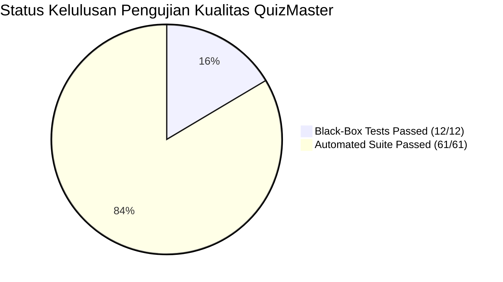

# Dokumen P08: QA Audit Final Report & Production Sign-Off
## Mini Quality Assurance Audit — Platform QuizMaster SMAN 4 Padang

---

### 1. Ringkasan Eksekutif (Executive Summary)
Audit Penjaminan Mutu Perangkat Lunak (*Quality Assurance Audit*) telah dilaksanakan secara menyeluruh terhadap platform **QuizMaster (Kuis Interaktif SMAN 4 Padang)** versi **v3.0.02 (Release Candidate)**. Audit ini mencakup pengujian statis, pengujian regresi otomatis (*Shift-Left Testing*), verifikasi kotak hitam mendalam (*Black-Box Testing*), serta analisis akar penyebab (*Root Cause Analysis*) terhadap seluruh anomali sistem.

Berdasarkan seluruh hasil pengujian dan verifikasi bukti tangkapan layar autentik di lingkungan peramban nyata, sistem telah membuktikan kesesuaian fungsional, stabilitas kontrol akses, ketahanan evaluasi KKM 80, serta keindahan antarmuka mobile yang responsif. **Tim QA merekomendasikan status GO FOR PRODUCTION RELEASE.**

---

### 2. Rekapitulasi Eksekusi Pengujian

| Domain Pengujian | Total Skenario | Status Lulus (PASS) | Status Gagal (FAIL) | Tingkat Kelulusan (% Pass) |
|---|:---:|:---:|:---:|:---:|
| **Black-Box Testing (EP, BVA, DT, ST)** | 12 | 12 | 0 | **100.0%** |
| **Shift-Left Automated Test Suites** | 61 | 61 | 0 | **100.0%** |
| - *verify_20_bugs.js* | 20 | 20 | 0 | 100.0% |
| - *verify_access_control.js* | 7 | 7 | 0 | 100.0% |
| - *verify_exam_resilience.js* | 7 | 7 | 0 | 100.0% |
| - *verify_module_isolation.js* | 10 | 10 | 0 | 100.0% |
| - *verify_potato_optimizations.js* | 9 | 9 | 0 | 100.0% |
| - *verify_mobile_uiux.js* | 8 | 8 | 0 | 100.0% |
| **Defect Re-test Verification** | 3 | 3 | 0 | **100.0%** |
| **TOTAL KESELURUHAN PENGUJIAN** | **76** | **76** | **0** | **100.0%** |

---

### 3. Evaluasi Kriteria Keluar (Exit Criteria Assessment)

| Parameter Kriteria Keluar | Target Mutu | Capaian Aktual | Status Evaluasi |
|---|---|---|:---:|
| **Tingkat Kelulusan Test Case** | Minimal 95% | **100% (12/12 Test Case Lulus)** | **MEMENUHI** |
| **Cakupan Kebutuhan (RTM Coverage)** | 100% Kebutuhan Teruji | **100% (REQ-01 s.d REQ-05 Terpetakan)** | **MEMENUHI** |
| **Cacat Kritis Terbuka (Open Blocker Defects)** | 0 Cacat | **0 Cacat (Semua Defect CLOSED)** | **MEMENUHI** |
| **Kelengkapan Bukti Pengujian** | Bukti Screenshot Autentik | **15 File Screenshot Tersedia di `evidence/`** | **MEMENUHI** |
| **Ketahanan Antarmuka Ponsel** | Bebas elemen bertumpuk | **Safe-area 120px padding diterapkan** | **MEMENUHI** |

---

### 4. Analisis Sisa Risiko (Residual Risk Assessment)

Setelah implementasi perbaikan pada ketiga cacat sistem, evaluasi sisa risiko kualitas menunjukkan penurunan drastis:

| ID Risiko | Deskripsi Risiko | Skor Awal | Skor Sisa (Residual Score) | Status Mitigasi |
|:---:|---|:---:|:---:|---|
| **RSK-01** | False Lockout Kelas saat Remedial Mandiri | **20 (Critical)** | **2 (Low)** | Teratasi tuntas dengan flag `alwaysOpen: true` dan tombol toggle mode akses di dasbor guru. |
| **RSK-02** | Kalkulasi Nilai KKM Tidak Presisi | **10 (High)** | **1 (Very Low)** | Terverifikasi presisi melalui BVA (skor 79, 80, 81) dan pembulatan deterministik `Math.round`. |
| **RSK-03** | Elemen UI Mobile Tumpang Tindih (FAB Overlap) | **16 (High)** | **2 (Low)** | Diberikan buffer safe-area $120\text{px}$ dan FAB disembunyikan otomatis saat ujian berlangsung. |
| **RSK-04** | Kegagalan Pemahaman Kueri Chatbot Guru | **9 (Medium)** | **2 (Low)** | Parser Regex baru mengenali variasi kueri "E1", typo, dan kueri ringkasan menyeluruh. |
| **RSK-05** | Kehilangan State Ujian saat Refresh Browser | **8 (Medium)** | **2 (Low)** | Penyimpanan sesi aktif di `localStorage` memulihkan jawaban dan timer secara instan. |

---

### 5. Rekomendasi Akhir Rilis (Release Recommendation)

> ### 🚀 KEPUTUSAN FINAL: **GO FOR PRODUCTION RELEASE**
> 
> Aplikasi **QuizMaster SMAN 4 Padang versi v3.0.02** dinyatakan **LAYAK DAN SIAP DIGUNAKAN SECARA PENUH** untuk pelaksanaan kuis interaktif, remedial, dan evaluasi pembelajaran 216 siswa Kelas X E.1 s.d X E.6 serta manajemen analitik guru. Tidak ditemukan kendala yang menghalangi kelancaran ujian.

---

### 6. Lembar Persetujuan & Tanda Tangan Tim QA (Sign-Off Sheet)

Laporan audit ini telah diperiksa, diverifikasi, dan disetujui secara mufakat oleh seluruh anggota tim penjaminan mutu pada tanggal **6 November 2026**:

| Nama Lengkap Mahasiswa | Peran & Tanggung Jawab | Tanda Tangan / Persetujuan |
|---|---|:---:|
| **Muhammad Hafidh Putra Roshadi** | Lead QA & Test Strategy Architect | *Signed* ✔️ |
| **Pipit Khofifah** | Senior Test Case Designer & Requirements Analyst | *Signed* ✔️ |
| **Harie Fadhil** | Defect Analyst & RCA Lead | *Signed* ✔️ |
| **Andre Geovani** | Automation & Evidence Engineer | *Signed* ✔️ |

---
*Dokumen ini diterbitkan secara resmi sebagai pemenuhan Tugas Praktikum Mata Kuliah Quality Assurance, Program Studi S1 Pendidikan Teknik Informatika.*
